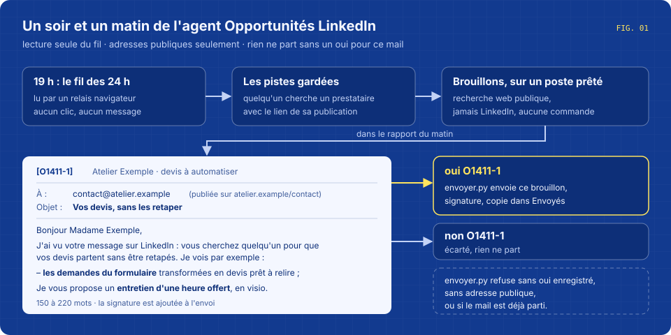
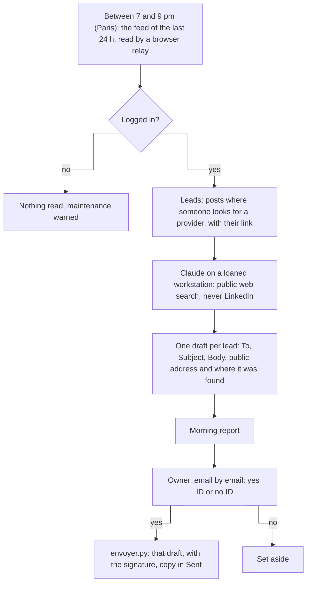
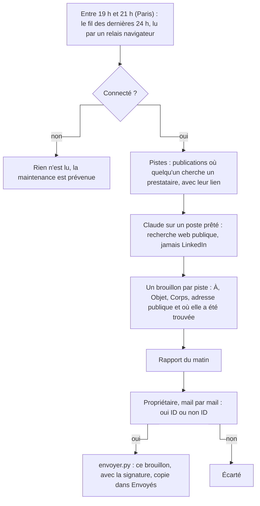

# Agent - LinkedIn opportunities

Every evening, it reads the LinkedIn feed of the last 24 hours, spots the people who are looking for a provider, and drafts a first email for each; an email leaves only after a yes for that exact email.





**English** · [Français](#version-française)

## What it does

- **Reads the feed every evening, between 7 and 9 pm Paris time.** `lecture.sh` hands its instructions to a browser relay on another machine, where a dedicated browser is logged in to LinkedIn. The relay scrolls the feed back past 24 hours, 300 posts at most, in 25 minutes at most, and keeps the posts where someone is looking for someone to build automation, AI, an agent, a chatbot, an app, a website or a custom tool. Job offers from large companies, ads and people selling themselves are left out.
- **Keeps only leads that have a real link** to the post, and says in the report when the 24 hours were not read in full.
- **Leaves the relay machine as it found it.** If it was off before the reading, it is turned off again afterwards, unless a game or another agent is running on it.
- **Writes the drafts on a loaned workstation.** For each post not seen before (`deja-vus.txt`), Claude finds the person's organisation by a public web search, then a public contact address (contact page, legal notice, generic address of the company) and cites the page where it read it. If there is none, it writes `null`. The draft follows `modele-mail.txt`: where the contact comes from, who the sender is in one sentence, three concrete ideas for this need, a free one-hour video call, two links. 150 to 220 words, a few words in bold. Posts that are not a real need for a provider are set aside with the reason.
- **Puts the full drafts in the morning report**: From, To, Subject, Body, and why it is a good lead. If no workstation was free, the report gives the raw leads instead.
- **Sends one email after one yes.** `envoyer.py <ID>` sends that draft from the Ingevision mailbox, with the signature and the HTML layout; the words between `**` become bold in the HTML version and lose their stars in the text version. A copy goes to the Sent folder and the proof to `envoyes/<ID>.json`.
- **Asks for a hand when LinkedIn is logged out.** It reads nothing, and maintenance is told that someone has to log in once, by hand, in the dedicated browser. No agent stores a password.

It is meant for a freelancer whose network sometimes posts "who can do this for us?", and who wants to answer the same week with a precise email instead of a quick comment.

## The morning report

```
Fil lu : 214 publications (jusqu'à 1 j) ; 2 personne(s) qui cherchent un prestataire.

À VALIDER, mail par mail (1) — en session : « oui O…-n » envoie CE mail tel quel depuis anthony@ingevision.cloud (signature Ingevision) ; « non O…-n » l'écarte :

[O1411-1] Camille Exemple — Atelier Exemple : faire partir les devis sans les retaper à la main
Publication : https://www.linkedin.com/feed/update/urn:li:activity:0000000000000000000
De : Anthony Hunt <anthony@ingevision.cloud>
À : contact@atelier.example (adresse publiée sur https://atelier.example/contact)
Objet : Vos devis, sans les retaper

Bonjour Madame Exemple,

J'ai vu votre message sur LinkedIn : vous cherchez quelqu'un pour que vos devis partent sans être retapés. […]

- **les demandes du formulaire** transformées en devis prêt à relire ;
- […]

Je vous propose un **entretien d'une heure offert**, en visio. […]

Pourquoi : besoin précis et dans le métier, petite équipe, publication d'hier.
Écartée : https://www.linkedin.com/feed/update/urn:li:activity:0000000000000000001 — offre d'emploi en CDI, pas un besoin de prestataire.
```
*(fictional example; the report is written in French)*

## What it never does

- Like, comment, repost, follow, send a message, open a profile or post on LinkedIn.
- Open LinkedIn while writing the drafts.
- Guess an email address or take one from an address directory or a personal profile.
- Send an email without a yes for that ID, send one with no address, or send the same one twice.
- Save a LinkedIn password.

**What the code holds, and what only the instructions hold.** The reading of the feed happens in a browser relay that is outside this repository; "read only" there holds by the instructions given to it (`consigne-lecture.md`), not by code. The drafting is held by code: `redaction.sh` gives Claude `Read`, `WebSearch`, `WebFetch` and writing to one file only, refuses `Bash` and refuses `WebFetch` on linkedin.com. Sending is held by code too: `envoyer.py` stops if `validations/<ID>.json` does not say `oui`, if the draft has no address, or if `envoyes/<ID>.json` already exists. Not guessing addresses holds by the instructions.

## Requirements

Taken from `lecture.sh`, `redaction.sh`, `deposer.py` and `envoyer.py`:

- A Linux server with `bash`, `cron`, `flock`, `perl`, `python3`, GNU `date` and `ssh`.
- A browser relay script that takes instructions and drives a dedicated browser logged in to LinkedIn, on a machine reachable as SSH host `tour`. It must end with a line `RESULTAT_JSON: {...}`, or answer `NON CONNECTÉ`. To turn that machine off again, `sudo -n systemctl poweroff` must be allowed there.
- A launcher that starts a Claude Code agent on a loaned workstation, an account selector and the token files it reads, [Claude Code](https://code.claude.com/docs/en/overview) on the workstation. The drafting waits in the same queue as other agents (`/tmp/agents-site.lock`), one hour at most, and lasts 50 minutes at most.
- A mailbox reachable by SMTP and IMAP over SSL; its address and password in a JSON file (`adresse`, `mdp`) read by `envoyer.py`. The server names are written in `envoyer.py`.
- The `mail_gabarit` module (`gabarit`, `paragraphe`) that lays out the HTML email.
- Outside this repository: the tool that builds the morning report, the maintenance signal, and the step that records the owner's answer in `validations/<ID>.json` and then calls `envoyer.py <ID>`.

The paths under `/home/claude` are written in the scripts; on another installation, change them.

## Install

```bash
git clone https://github.com/anthohunt/agent-opportunites-linkedin
cd agent-opportunites-linkedin
mkdir -p rapports validations envoyes        # the scripts do not create these three
$EDITOR modele-mail.txt                      # your own first-contact email, the one the drafts will follow
mkdir -p /home/claude/.config/secrets/ingevision
cat > /home/claude/.config/secrets/ingevision/boite-anthony.json <<'EOF'
{"adresse": "vous@example.org", "mdp": "mot de passe de la boîte"}
EOF
chmod 600 /home/claude/.config/secrets/ingevision/boite-anthony.json
FORCE=1 ./lecture.sh                         # one reading now, then the drafting in the background
python3 deposer.py "$(TZ=Europe/Paris date +%F)" --apercu
echo '{"decision": "oui"}' > validations/O1411-1.json && python3 envoyer.py O1411-1 --essai
# crontab: lecture.sh checks Paris time itself and only works between 7 and 9 pm
# 0,30 * * * * /chemin/lecture.sh
```

`lecture.sh` creates `logs/`, `etat/` and `verrous/`; a marker in `logs/` stops a second reading the same day. `deposer.py <date> --apercu` prints the part of the morning report without sending it; `envoyer.py <ID> --essai` builds the email and shows its recipient and subject without sending it. All the working folders stay out of git.

## Files

| File | Role |
|---|---|
| `lecture.sh` | The evening reading: asks the relay to read the feed, keeps the leads with a real link, turns the relay machine off again if it was off, starts the drafting. |
| `consigne-lecture.md` | The instructions given to the browser relay: read only, the last 24 hours, what counts as a lead, the format of the result. |
| `redaction.sh` | Starts Claude on a loaned workstation for the drafts, with its limited rights, then files the report. |
| `consigne-redaction.md` | How to write a draft: public address, the plan of the email, the bold words, the tone, the length. |
| `modele-mail.txt` | The model of a first-contact email (anonymised). |
| `deposer.py` | Writes the LinkedIn opportunities part of the morning report. |
| `envoyer.py` | Sends one validated draft, with the signature, and keeps the proof. |
| `deja-vus.txt` | Links of the posts already handled, created on the first drafting, outside git. |

The instructions and comments are in French. It is one of the permanent agents that run on their own every day in a small system of Claude Code agents.

## Its page

The page of this agent on ingevision.cloud is not published yet.

---

## Version française

# Agent - Opportunités LinkedIn

Chaque soir, il lit le fil LinkedIn des dernières 24 heures, repère les personnes qui cherchent un prestataire et prépare pour chacune un premier mail ; un mail ne part qu'après un oui pour ce mail précis.




### Ce qu'il fait

- **Lit le fil chaque soir, entre 19 h et 21 h, heure de Paris.** `lecture.sh` confie sa consigne à un relais navigateur sur une autre machine, où un navigateur dédié est connecté à LinkedIn. Le relais fait défiler le fil au-delà de 24 heures, 300 publications au plus, en 25 minutes au plus, et garde les publications où quelqu'un cherche quelqu'un pour de l'automatisation, de l'IA, un agent, un chatbot, une appli, un site ou un outil sur mesure. Les offres d'emploi des grandes entreprises, la publicité et les gens qui se vendent eux-mêmes sont laissés de côté.
- **Ne garde que les pistes qui ont un vrai lien** vers la publication, et dit dans le rapport quand les 24 heures n'ont pas été lues en entier.
- **Laisse la machine du relais comme il l'a trouvée.** Si elle était éteinte avant la lecture, elle est rééteinte après, sauf si un jeu ou un autre agent y tourne.
- **Écrit les brouillons sur un poste prêté.** Pour chaque publication pas encore vue (`deja-vus.txt`), Claude trouve l'organisation de la personne par une recherche web publique, puis une adresse de contact publique (page contact, mentions légales, adresse générique de l'entreprise) et cite la page où il l'a lue. S'il n'en trouve pas, il écrit `null`. Le brouillon suit `modele-mail.txt` : d'où vient le contact, qui écrit en une phrase, trois idées concrètes pour ce besoin, un entretien d'une heure offert en visio, deux liens. 150 à 220 mots, quelques mots en gras. Ce qui n'est pas un vrai besoin de prestataire est écarté avec la raison.
- **Met les brouillons complets dans le rapport du matin** : De, À, Objet, Corps, et pourquoi c'est une bonne piste. Si aucun poste n'était libre, le rapport donne les pistes brutes à la place.
- **Envoie un mail après un oui.** `envoyer.py <ID>` envoie ce brouillon depuis la boîte Ingevision, avec la signature et la mise en page HTML ; les mots entre `**` passent en gras dans la version HTML et perdent leurs astérisques dans la version texte. Une copie va dans Envoyés et la preuve dans `envoyes/<ID>.json`.
- **Demande un coup de main quand LinkedIn est déconnecté.** Il ne lit rien, et la maintenance est prévenue qu'il faut se connecter une fois, à la main, dans le navigateur dédié. Aucun agent n'enregistre de mot de passe.

Il sert à un indépendant dont le réseau publie parfois « qui peut faire ça pour nous ? », et qui veut répondre dans la semaine par un mail précis plutôt que par un commentaire rapide.

### Le rapport du matin

```
Fil lu : 214 publications (jusqu'à 1 j) ; 2 personne(s) qui cherchent un prestataire.

À VALIDER, mail par mail (1) — en session : « oui O…-n » envoie CE mail tel quel depuis anthony@ingevision.cloud (signature Ingevision) ; « non O…-n » l'écarte :

[O1411-1] Camille Exemple — Atelier Exemple : faire partir les devis sans les retaper à la main
Publication : https://www.linkedin.com/feed/update/urn:li:activity:0000000000000000000
De : Anthony Hunt <anthony@ingevision.cloud>
À : contact@atelier.example (adresse publiée sur https://atelier.example/contact)
Objet : Vos devis, sans les retaper

Bonjour Madame Exemple,

J'ai vu votre message sur LinkedIn : vous cherchez quelqu'un pour que vos devis partent sans être retapés. […]

- **les demandes du formulaire** transformées en devis prêt à relire ;
- […]

Je vous propose un **entretien d'une heure offert**, en visio. […]

Pourquoi : besoin précis et dans le métier, petite équipe, publication d'hier.
Écartée : https://www.linkedin.com/feed/update/urn:li:activity:0000000000000000001 — offre d'emploi en CDI, pas un besoin de prestataire.
```
*(exemple fictif)*

### Ce qu'il ne fait jamais

- Aimer, commenter, republier, suivre, envoyer un message, ouvrir un profil ou publier sur LinkedIn.
- Ouvrir LinkedIn pendant l'écriture des brouillons.
- Deviner une adresse mail, ou en prendre une dans un annuaire d'adresses ou sur un profil personnel.
- Envoyer un mail sans un oui pour cet identifiant, en envoyer un sans adresse, ou envoyer deux fois le même.
- Enregistrer un mot de passe LinkedIn.

**Ce que le code garantit, et ce qui ne tient qu'à la consigne.** La lecture du fil se fait dans un relais navigateur qui est hors de ce dépôt ; la « lecture seule » y tient à la consigne qu'on lui donne (`consigne-lecture.md`), pas au code. La rédaction est tenue par le code : `redaction.sh` donne à Claude `Read`, `WebSearch`, `WebFetch` et l'écriture d'un seul fichier, refuse `Bash` et refuse `WebFetch` sur linkedin.com. L'envoi aussi : `envoyer.py` s'arrête si `validations/<ID>.json` ne dit pas `oui`, si le brouillon n'a pas d'adresse, ou si `envoyes/<ID>.json` existe déjà. Ne pas deviner d'adresse tient à la consigne.

### Ce qu'il faut

Tiré de `lecture.sh`, `redaction.sh`, `deposer.py` et `envoyer.py` :

- Un serveur Linux avec `bash`, `cron`, `flock`, `perl`, `python3`, `date` de GNU et `ssh`.
- Un script relais qui reçoit une consigne et pilote un navigateur dédié connecté à LinkedIn, sur une machine joignable sous le nom SSH `tour`. Il doit finir par une ligne `RESULTAT_JSON: {...}`, ou répondre `NON CONNECTÉ`. Pour rééteindre cette machine, `sudo -n systemctl poweroff` doit y être permis.
- Un lanceur qui démarre un agent Claude Code sur un poste prêté, un sélecteur de compte et les fichiers de jetons qu'il lit, [Claude Code](https://code.claude.com/docs/en/overview) sur le poste. La rédaction attend dans la même file que d'autres agents (`/tmp/agents-site.lock`), une heure au plus, et dure 50 minutes au plus.
- Une boîte mail joignable en SMTP et IMAP sur SSL ; son adresse et son mot de passe dans un fichier JSON (`adresse`, `mdp`) lu par `envoyer.py`. Les noms des serveurs sont écrits dans `envoyer.py`.
- Le module `mail_gabarit` (`gabarit`, `paragraphe`) qui met en page le mail HTML.
- Hors de ce dépôt : l'outil qui assemble le rapport du matin, le signalement à la maintenance, et l'étape qui enregistre la réponse du propriétaire dans `validations/<ID>.json` puis appelle `envoyer.py <ID>`.

Les chemins sous `/home/claude` sont écrits dans les scripts ; sur une autre installation, il faut les changer.

### Installation

```bash
git clone https://github.com/anthohunt/agent-opportunites-linkedin
cd agent-opportunites-linkedin
mkdir -p rapports validations envoyes        # les scripts ne créent pas ces trois dossiers
$EDITOR modele-mail.txt                      # votre propre premier mail, celui que suivront les brouillons
mkdir -p /home/claude/.config/secrets/ingevision
cat > /home/claude/.config/secrets/ingevision/boite-anthony.json <<'EOF'
{"adresse": "vous@example.org", "mdp": "mot de passe de la boîte"}
EOF
chmod 600 /home/claude/.config/secrets/ingevision/boite-anthony.json
FORCE=1 ./lecture.sh                         # une lecture tout de suite, puis la rédaction en arrière-plan
python3 deposer.py "$(TZ=Europe/Paris date +%F)" --apercu
echo '{"decision": "oui"}' > validations/O1411-1.json && python3 envoyer.py O1411-1 --essai
# crontab : lecture.sh vérifie lui-même l'heure de Paris et ne travaille qu'entre 19 h et 21 h
# 0,30 * * * * /chemin/lecture.sh
```

`lecture.sh` crée `logs/`, `etat/` et `verrous/` ; une marque dans `logs/` empêche une deuxième lecture le même jour. `deposer.py <date> --apercu` affiche la partie du rapport du matin sans l'envoyer ; `envoyer.py <ID> --essai` construit le mail et montre son destinataire et son objet sans l'envoyer. Tous les dossiers de travail restent hors de git.

### Fichiers

| Fichier | Rôle |
|---|---|
| `lecture.sh` | La lecture du soir : demande au relais de lire le fil, garde les pistes qui ont un vrai lien, rééteint la machine du relais si elle l'était, lance la rédaction. |
| `consigne-lecture.md` | La consigne donnée au relais navigateur : lecture seule, les dernières 24 heures, ce qui compte comme piste, le format du résultat. |
| `redaction.sh` | Lance Claude sur un poste prêté pour les brouillons, avec ses droits limités, puis dépose le rapport. |
| `consigne-redaction.md` | Comment écrire un brouillon : adresse publique, plan du mail, mots en gras, ton, longueur. |
| `modele-mail.txt` | Le modèle d'un premier mail (anonymisé). |
| `deposer.py` | Écrit la partie opportunités LinkedIn du rapport du matin. |
| `envoyer.py` | Envoie un brouillon validé, avec la signature, et garde la preuve. |
| `deja-vus.txt` | Les liens des publications déjà traitées, créé à la première rédaction, hors de git. |

Fait partie des agents permanents qui tournent seuls chaque jour dans un petit système d'agents Claude Code.

### Sa fiche

La fiche de cet agent sur ingevision.cloud n'est pas encore publiée.

---

**Anthony Hunt** · [AI agents on ingevision.cloud](https://ingevision.cloud/en/ai-agents/) · [LinkedIn](https://www.linkedin.com/in/anthony-hunt-3948a9196) · [GitHub profile](https://github.com/anthohunt) · anthony@ingevision.cloud
